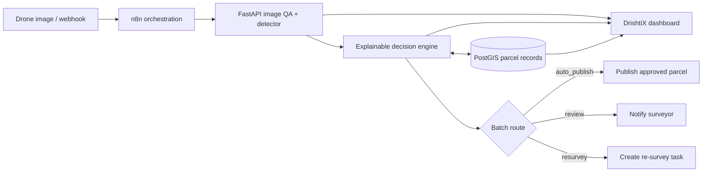

# DrishtiX Flow

**From drone to decision, on autopilot.** DrishtiX Flow is an explainable parcel-mapping pipeline that turns aerial tiles and scattered GIS records into an auditable decision — approve, flag, or re-survey — with a lightweight human-review path for exceptions.

## The problem

Drone parcel-mapping teams repeatedly move between imagery, AI detections, and GIS records to check boundary confidence, image quality, and area differences. That manual reconciliation slows publication and makes inconsistent calls difficult to audit.

## What this project does

- Accepts drone imagery and runs blur/brightness QA before inference.
- Runs local Ultralytics YOLO weights from `models/parcels.pt` when present; uses a deterministic simulated detector otherwise.
- Compares detections against GIS parcel references and applies transparent confidence, overlap, and area rules.
- Routes each result to auto-publish, surveyor review, or a re-survey task.
- Persists parcel references and decision history in PostGIS; exposes a responsive live dashboard and history API.
- Orchestrates the upload → detect → decide → act lifecycle with an importable n8n workflow.

## Architecture



### Stack

- **Workflow:** n8n 1.82, Docker Compose
- **API:** Python 3.11, FastAPI, Pydantic
- **Vision:** Ultralytics YOLO (optional local weights) + deterministic demo detector, Pillow QA
- **Spatial data:** PostGIS 16 / PostgreSQL 16
- **UI:** Single-file HTML, CSS, and JavaScript; MapLibre GL JS parcel layer

## Explainable decision rules

| Condition | Decision | Why |
| --- | --- | --- |
| Image is blurry, too dark, or QA failed | `RESURVEY` | Boundaries cannot be trusted from this capture |
| Confidence is below 0.60 | `RESURVEY` | Detection confidence is below the minimum |
| GIS record is missing | `FLAG` | Human needs to reconcile the parcel reference |
| Confidence ≥ 0.85, IoU ≥ 0.70, area mismatch ≤ 25% | `APPROVE` | All auto-publish checks pass |
| IoU < 0.70, area mismatch > 25%, or confidence < 0.85 | `FLAG` | Evidence is retained for a human decision |

Rules are evaluated in order: image QA and low confidence take precedence over GIS matching. Every per-parcel decision includes a `reasons` list. Batch output includes action counts, `automation_rate` (approved detections / all detections), and `batch_action` (`auto_publish`, `review`, or `resurvey`).

## Quick start

### Docker (recommended)

Requires Docker Engine and the Docker Compose v2 plugin.

```bash
docker compose up --build -d
```

- Dashboard + API: <http://localhost:8000>
- OpenAPI docs: <http://localhost:8000/docs>
- n8n editor: <http://localhost:5678>
- PostGIS: `localhost:5432` (database/user `drishtix`; development password `drishtix_dev`)

Run the demo tile end-to-end:

```bash
make demo
```

The dashboard also has **Use sample tile**, drag-and-drop upload controls, and a policy sandbox for previewing stricter confidence thresholds without changing recorded decisions. Stop services with `docker compose down`; retain the data volumes. Use `docker compose down -v` only when intentionally deleting the local database and n8n state.

### Run the API locally

Requires Python 3.11+.

```bash
python3 -m venv .venv
source .venv/bin/activate
pip install -r requirements.txt
python3 tools/generate_sample.py
uvicorn api.app.main:app --reload
```

The API uses in-memory decision history when `DATABASE_URL` is not set. To run actual local YOLO inference, install a PyTorch build suitable for your machine plus `ultralytics`, then put compatible weights at `models/parcels.pt` (weights are ignored by Git). Without weights, the demo detector is deterministic.

## n8n workflow setup

1. Start the stack, open <http://localhost:5678>, and finish the initial n8n owner setup.
2. Import `workflows/drishtix_flow.json` from the n8n Workflows menu.
3. Open **Save approved parcel to PostGIS** and create/select a Postgres credential: host `postgis`, port `5432`, database/user `drishtix`, password matching `POSTGRES_PASSWORD` (defaults to `drishtix_dev` inside this development Compose stack), SSL disabled for local Docker networking.
4. Save and activate the workflow. Its production webhook is `POST http://localhost:5678/webhook/drishtix-upload`; use the n8n test URL while in test mode.
5. Send multipart form data with the image field named `data` (the workflow forwards it to the API as `file`).

The API writes each decision before routing. The approved path records publication in `published_parcels`; review/re-survey paths queue a notification record through `/notify`, which is the adapter boundary for Slack, email, or a survey-management integration.

## API

| Method | Endpoint | Purpose |
| --- | --- | --- |
| `GET` | `/health` | Liveness check |
| `POST` | `/detect` | Multipart image upload (`file`); returns QA and detections |
| `POST` | `/decide` | JSON detections + QA; returns explainable decisions and batch summary |
| `GET` | `/records?limit=100` | Decision history and parcel map features |
| `POST` | `/notify` | Queue surveyor/re-survey notification payload |
| `GET` | `/docs` | Interactive OpenAPI documentation |

Example `/decide` request:

```json
{
  "batch_id": "8d8ab41c-75ba-4b4b-b5ee-b86ad0611019",
  "image_qa": {"is_blurry": false, "is_too_dark": false, "sharpness": 8.4, "brightness": 126.0, "passed": true},
  "detections": [{"parcel_id": "P-104", "confidence": 0.93, "area_m2": 1210, "iou": 0.84, "bbox": [0.18, 0.16, 0.79, 0.82]}]
}
```

## Tests and project commands

```bash
make test       # pytest decision-rule suite
make up         # build and start API, n8n, PostGIS
make demo       # start the stack and submit the sample image through detect + decide
```

## Screenshots

The dashboard is served at `/` and is responsive for desktop and mobile. Capture the running dashboard after `make up` to add a current screenshot here; no fabricated product screenshots are included in the repository.

## Roadmap

- Connect `/notify` to Slack/email and a surveyor task system.
- Use georeferenced orthomosaics and real parcel geometry for spatial IoU rather than demo overlap metadata.
- Add multi-detection batching, per-flight audit exports, and role-based approvals.
- Add model/version provenance, calibrated confidence monitoring, and offline field capture support.
- Add authenticated upload, image retention policy, and production secret management before deployment.

## Repository layout

```text
api/app/                 FastAPI routes, detector, storage, decision engine
api/tests/               Decision-engine pytest suite
database/init.sql        PostGIS schema and demo parcels
models/                  Optional local detector weights (not committed)
sample_data/              Generated demo tile
tools/                    Sample image generator and demo client
web/index.html            Responsive dashboard
workflows/                Importable n8n workflow export
Dockerfile
docker-compose.yml
Makefile
```

## License

Add the license selected by the project team before public distribution.
